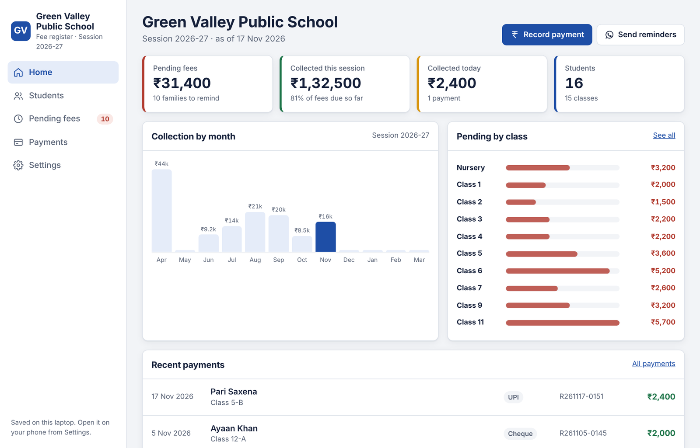
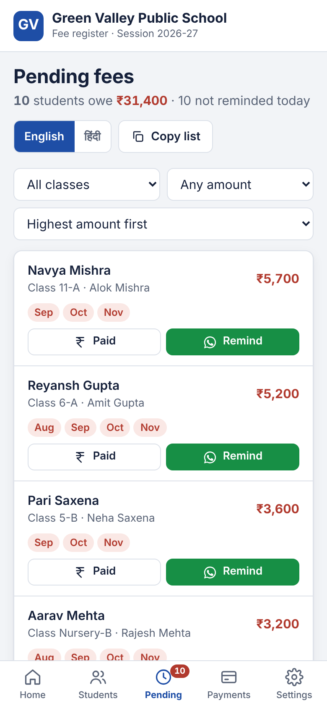
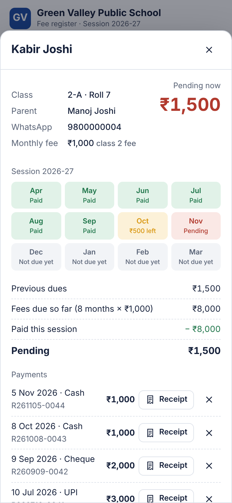
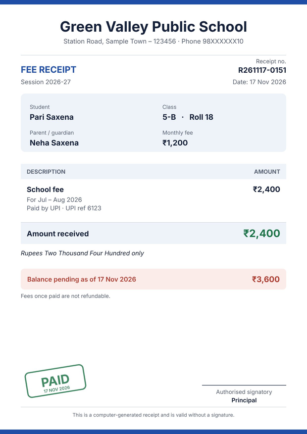

# School Fee Register

A free, self-hosted fee manager for small schools. It keeps student records, tracks monthly fees, shows who owes what, sends fee reminders on WhatsApp in English or Hindi, and makes PDF receipts.

It runs on one laptop with nothing to install except Python. Phones on the same Wi‑Fi can use it too.



<p align="center">
  
  &nbsp;&nbsp;
  
  &nbsp;&nbsp;
  
</p>

> All names and numbers in the screenshots are made-up demo data.

## Features

- **Students:** name, class, section, roll number, parent, WhatsApp number. Import a whole class from an Excel CSV.
- **Fees:** monthly, quarterly, half-yearly or yearly collection. Each student is either on their **class fee** or has a **custom fee** (discounts, siblings, transport). Covers mid-session admissions, previous dues and one-time charges.
- **Pending fees:** works out exactly which months are unpaid, handles part payments, and filters by class or months overdue.
- **WhatsApp reminders:** one tap opens WhatsApp with a polite, pre-written message for that parent. English and Hindi templates, both editable.
- **PDF receipts:** an A5 receipt for every payment, showing months covered, amount in words, balance left and a PAID stamp. Download one, or download a whole period as one PDF.
- **Dashboard:** collected vs pending, collection by month, pending by class, today's collection.
- **New session:** carries unpaid fees forward and moves every student up one class.
- **Phone access:** open it on any phone on the same Wi‑Fi. Protected by a PIN, and works like an app when added to the home screen.
- **Backups:** automatic daily database backups (last 60 kept), plus CSV export for Excel.
- **Private:** all data stays on the school's own laptop. No cloud, no accounts, no tracking.

## Quick start

**Requirements:** Python 3.8 or newer. No packages to install.

```bash
git clone https://github.com/Prakhar1502/school_project.git
cd school_project
python server.py
```

On Windows, you can instead double-click **`start-windows.bat`**. On Mac or Linux, run **`./start-mac-linux.sh`**.

On first start you choose a PIN. The register then opens at <http://localhost:8000>. To use it on a phone, open **Settings → Use on your phone** and scan the QR code. The phone must be on the same Wi‑Fi.

```text
python server.py --port 8001     use another port
python server.py --no-browser    don't open the browser on start
python server.py --reset-pin     choose a new PIN (signs out every device)
```

For a step-by-step guide written for school staff (installing Python, phone setup, auto-start, backups, receipts), see **[docs/USER-GUIDE.md](docs/USER-GUIDE.md)**.

## How fees are calculated

- The session starts in a chosen month (April by default) and runs for 12 months.
- A month's fee counts as due from the chosen **due day** (default: the 10th). With quarterly collection, a whole quarter becomes due at its start.
- Payments clear **previous dues** first, then **one-time charges**, then months in order, oldest first. A partly paid month shows as "part".
- A student who joined mid-session is only charged from their joining month.
- **Start new session** turns the whole year's unpaid amount into next year's previous dues. Advance payments carry over as credit.

## How it works

```
index.html     the whole app: plain HTML, CSS and JavaScript, no build step, no framework
server.py      Python standard library only: HTTP server, SQLite storage, PIN sign-in, daily backups
data/          created on first run, never committed (see .gitignore)
  fees.db      SQLite database: students (one JSON document each, with their payments) and settings
  backups/     fees-YYYY-MM-DD.db, one per day
```

- **API:** `GET /api/state` (with a revision number so polling is cheap), `PUT/PATCH/DELETE /api/students/<id>`, `PUT /api/settings`, `POST /api/login`, `POST /api/logout`, `GET /api/info`.
- **Sync:** every open device polls about every 6 seconds and whenever it comes back into view, so the laptop and phones stay in step.
- **Security:** the PIN is stored as a salted PBKDF2 hash. Sign-in tokens are HttpOnly cookies, stored hashed. Wrong PINs are rate-limited. Requests from other websites are refused (Origin check). The server only listens on your local network.
- **Receipts** are drawn on a `<canvas>`, so any script, including Hindi, renders correctly. They're written into a PDF by a tiny built-in writer, with no PDF library.
- **WhatsApp:** reminders use `wa.me` links, which pre-type the message. WhatsApp doesn't allow websites to attach files, so receipts are downloaded and attached in the chat. Where the browser supports file sharing (for example on `localhost`), a **Share PDF** button appears.
- `index.html` can also run as a Claude artifact, using its built-in storage. When it's served by `server.py`, it uses the local API.

## Limitations

- The laptop must be on, with the server running, for phones to connect. Phones only connect over the same Wi‑Fi. For remote access, see the optional Cloudflare tunnel section in the user guide.
- Reminders are sent one tap per parent. Fully automatic WhatsApp messages need the paid WhatsApp Business API.
- Built for a single school with up to a few thousand students.

## Contributing

Issues and pull requests are welcome. Please keep the project dependency-free (Python standard library, one HTML file), so it stays easy to run on any school laptop.

## License

[MIT](LICENSE)
